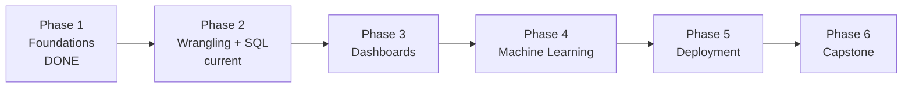

# DataTrove Data Science Graduate Placement — Curriculum

**Issued by:** Promise Ekeh, Head of Analytics
**Programme:** DataTrove Data Science Graduate Placement
**Duration:** ~16 weeks remaining, part-time (~10–15 hrs/week) — compressed to **6 phases**
**Level:** Beginner → Junior Data Analyst / Data Scientist
**Mode:** Simulated industrial placement, individual track

---

## Why this document exists

This is the master plan for your placement. It replaces the original Word document (`DataTrove_DS_Placement_Programme.docx`, archived in this folder) and becomes the single source of truth for what you are working on, when, and why.

Every task in the programme has its own brief in [`tasks/`](../tasks/). Every piece of feedback from me lives in [`feedbacks/`](../feedbacks/). Every weekly stand-up lives in [`feedbacks/standups/`](../feedbacks/standups/). If anyone (including a future you, or a future employer reading this repo) wants to understand what you did during your placement, this file is the index.

---

## The compression (read this first)

The original programme was **6 months, 7 phases, 40 tasks**. Phase 1 alone took roughly two months at your part-time pace, and about **16 weeks (~180 usable hours)** now remain. So we have compressed the programme from **7 phases to 6**, keeping the phased structure but tightening it:

1. **We keep every phase that builds a portfolio skill** — SQL & wrangling, dashboards, machine learning, deployment, and the capstone. These stay hands-on and in full.
2. **We fold the lighter phase into a neighbour as reading.** The old Phase 3 (statistics & experimentation) becomes a **reading task inside Phase 2** — known, not drilled. You already covered descriptive statistics in Phase 1.
3. **We drop peripheral topics to awareness-only.** Web scraping/APIs, unsupervised learning, time series, NLP, deep learning, and hands-on cloud/ETL-scheduling/CI-CD/monitoring become short readings with a stand-up note — revisitable after the placement.

**The trade-off, stated plainly:** 180 part-time hours cannot cover 40 tasks at depth. We keep depth on what gets you hired and accept reduced breadth elsewhere. The binding constraint is time, not ability — your DTS 202 university lab already showed a complete ML workflow.

---

## What you will be able to do at the end

By the time you finish all six phases you will be able to:

1. Take a messy real-world client export and carry it end-to-end: understand it, clean it, and interrogate it in both **pandas and SQL** (including CTEs and window functions).
2. Communicate findings through a written business report, a published **Power BI / Tableau dashboard**, and a live stakeholder presentation.
3. Build, evaluate, tune, and explain **machine learning models** — regression and classification — using scikit-learn pipelines, and write a responsible-AI model card.
4. Package model code into reusable scripts and **deploy a model behind a simple web app**.
5. Run an end-to-end data science **capstone** and defend your decisions to a stakeholder panel.
6. Speak with awareness about the topics we did not drill (experimentation, unsupervised/time-series/NLP/deep learning, cloud/MLOps) and know where to go to learn them properly.

---

## Programme structure



| Phase | Focus | Was | Must-keep skills |
|-------|-------|-----|------------------|
| 1 | Onboarding & Foundations | 1 | Python, Git, pandas, stats vocabulary — **DONE** |
| 2 | Data Wrangling & SQL | 2 (+3 as reading) | pandas, cleaning, **SQL (fundamentals + advanced)**, business writing |
| 3 | Visualisation & Dashboards | 4 | chart craft, **Power BI / Tableau**, stakeholder presentation |
| 4 | Machine Learning | 5 | **regression + classification**, pipelines, evaluation, model card |
| 5 | Deployment | 6 | reusable scripts, **model behind a web app** |
| 6 | Capstone | 7 | scoping, end-to-end build, final report & defence |

The whole of Phases 2–6 runs on **one client dataset — NorthStar Goods (£)** — so each phase deepens the same story rather than starting over.

**Dropped to awareness-only** (short reading + stand-up note, no build): web scraping/APIs; inferential statistics & experimentation beyond Phase 1 (folded into Phase 2 as reading); unsupervised learning, time series, NLP, deep learning; ETL scheduling, cloud, CI-CD, and monitoring.

---

## Phase 1 — Onboarding & Foundations ✅ DONE

You learned the tools of the trade: Python, the shell, Git/GitHub, Jupyter, NumPy, pandas, matplotlib, seaborn, and the statistical vocabulary you rely on for the rest of the programme.

| #     | Task                                 | Brief                                                                                | Status |
|-------|--------------------------------------|--------------------------------------------------------------------------------------|--------|
| 1.1   | Environment Setup & First Commit     | [task1_introductions.md](../tasks/phase1/task1_introductions.md)              | DONE |
| 1.2   | Python Foundations                   | [task2_python_foundations.ipynb](../tasks/phase1/task2_python_foundations.ipynb) | DONE |
| 1.3a  | Advanced Python Fundamentals         | [task3a_advanced_python_fundamentals.ipynb](../tasks/phase1/task3a_advanced_python_fundamentals.ipynb) | DONE |
| 1.3b  | Project Tooling (venv, requirements.txt, .gitignore) | [task3b_environment_and_tooling.md](../tasks/phase1/task3b_environment_and_tooling.md) | DONE |
| 1.3c  | Data Science Libraries (NumPy/pandas/matplotlib/seaborn) | [task3c_data_science_libraries.ipynb](../tasks/phase1/task3c_data_science_libraries.ipynb) | DONE |
| 1.4   | Statistics & Probability Foundations | [task4_statistics_foundations.md](../tasks/phase1/task4_statistics_foundations.md) | DONE |

*The original Task 1.5 (First EDA) now opens Phase 2, so your EDA lands on the real client dataset.*

---

## Phase 2 — Data Wrangling & SQL ← you are here

Take one messy client export — **NorthStar Goods** — and carry it the whole way: understand it, clean it, interrogate it in pandas and SQL, and finish with a board-ready report. Every task works the same dataset. The old Phase 3 (statistics & experimentation) is folded in here as a **reading task**.

| #    | Task                                | Brief                                                                          | Notes |
|------|-------------------------------------|--------------------------------------------------------------------------------|-------|
| 2.1  | First EDA on a Real Client Export   | [task1_eda.md](../tasks/phase2/task1_eda.md)                            | diagnose, don't fix |
| 2.2  | Clean It, Log Every Decision        | [task2_cleaning.md](../tasks/phase2/task2_cleaning.md)                  | produces `northstar_clean.csv` |
| 2.3  | Answer the Business with Pandas     | [task3_pandas_analysis.md](../tasks/phase2/task3_pandas_analysis.md)    | groupby / merge / reshape / time series |
| 2.4  | SQL Fundamentals                    | [task4_sql_fundamentals.md](../tasks/phase2/task4_sql_fundamentals.md)  | six clauses, joins, subqueries |
| 2.5  | SQL Advanced (CTEs & Windows)       | [task5_sql_advanced.md](../tasks/phase2/task5_sql_advanced.md)          | CTEs, ranking/aggregating/lag windows |
| 2.6  | The NorthStar Monthly Report        | [task6_monthly_report.md](../tasks/phase2/task6_monthly_report.md)      | first business deliverable |
| 2.7  | Statistics & Experimentation        | [task7_statistics_reading.md](../tasks/phase2/task7_statistics_reading.md) | **reading-only** (folds old Phase 3); web scraping/APIs also awareness-only |

---

## Phase 3 — Visualisation & Dashboards

Turn the NorthStar data into something the CEO glances at on a Tuesday. From chart-choice judgement, through Power BI/Tableau mechanics, to a published executive dashboard you stand up and defend.

| #    | Task                                | Brief                                                                          | Notes |
|------|-------------------------------------|--------------------------------------------------------------------------------|-------|
| 3.1  | Chart Craft                         | [task1_chart_craft.md](../tasks/phase3/task1_chart_craft.md)            | right chart, titled as a claim |
| 3.2  | BI Tool Fundamentals (Power BI/Tableau) | [task2_bi_fundamentals.md](../tasks/phase3/task2_bi_fundamentals.md) | load, model, measure, publish |
| 3.3  | The Executive Dashboard             | [task3_executive_dashboard.md](../tasks/phase3/task3_executive_dashboard.md) | sketch first, 30-second test |
| 3.4  | Stand Up and Defend It              | [task4_presentation.md](../tasks/phase3/task4_presentation.md)          | narrative-led stakeholder talk |

---

## Phase 4 — Machine Learning

Train, evaluate, and explain models on the NorthStar data — predict returns (classification) and price/order value (regression) — with honest, leakage-free scikit-learn pipelines, and close with a responsible-AI model card.

| #    | Task                                | Brief                                                                          | Notes |
|------|-------------------------------------|--------------------------------------------------------------------------------|-------|
| 4.1  | ML Workflow & scikit-learn Pipelines | [task1_ml_workflow_sklearn.md](../tasks/phase4/task1_ml_workflow_sklearn.md) | `Pipeline` / `ColumnTransformer` |
| 4.2  | Regression                          | [task2_regression.md](../tasks/phase4/task2_regression.md)              | predict price / order value |
| 4.3  | Classification                      | [task3_classification.md](../tasks/phase4/task3_classification.md)      | predict `returned` |
| 4.4  | Feature Engineering                 | [task4_feature_engineering.md](../tasks/phase4/task4_feature_engineering.md) | encodings, interactions |
| 4.5  | Model Evaluation & Tuning           | [task5_evaluation_and_tuning.md](../tasks/phase4/task5_evaluation_and_tuning.md) | cross-validation, GridSearch |
| 4.6  | Model Card & Responsible AI         | [task6_model_card_responsible_ai.md](../tasks/phase4/task6_model_card_responsible_ai.md) | fairness audit + model card |

> **Note.** These briefs live in [`tasks/phase4/`](../tasks/phase4/) and are renumbered, but their bodies still reference the older "Beacon" example. I'll re-point them to the NorthStar dataset (predict `returned`, and price / order value) when we start this phase. **Dropped to awareness-only:** unsupervised learning, time series, NLP, deep learning.

---

## Phase 5 — Deployment

A model in a notebook is a demo; a model behind a web app is a product. Package the Phase 4 model into reusable scripts and deploy it so a non-technical user can get a prediction without touching Python.

| #    | Task                                | Brief                                                                          | Notes |
|------|-------------------------------------|--------------------------------------------------------------------------------|-------|
| 5.1  | Reusable Scripts & Automation       | [task1_scripts_and_automation.md](../tasks/phase5/task1_scripts_and_automation.md) | notebook → tested scripts |
| 5.2  | Model Deployment (web app)          | [task2_model_deployment.md](../tasks/phase5/task2_model_deployment.md)  | Streamlit / FastAPI, hosted |

> **Note.** These briefs live in [`tasks/phase5/`](../tasks/phase5/) and are renumbered, but their bodies still reference the earlier Beacon model; I'll re-point them to your NorthStar model at the start of this phase. **Dropped to awareness-only:** SQLite ETL, scheduling & workflows, cloud foundations, CI/CD & monitoring.

---

## Phase 6 — Capstone

The exam. An open-ended brief, no scaffolding, your decisions defended in front of a panel. It extends your Phase 4 + Phase 5 work into one clean, reproducible portfolio piece and carries the model card forward.

| #    | Task                                | Brief                                                                          | Notes |
|------|-------------------------------------|--------------------------------------------------------------------------------|-------|
| 6.1  | Capstone Scoping & Proposal         | [task1_capstone_scoping.md](../tasks/phase6/task1_capstone_scoping.md)  | scope the polished piece |
| 6.2  | Capstone End-to-End Build           | [task2_capstone_build.md](../tasks/phase6/task2_capstone_build.md)      | analysis → model → dashboard |
| 6.3  | Final Report & Presentation         | [task3_final_report_and_presentation.md](../tasks/phase6/task3_final_report_and_presentation.md) | report + defence |

> **Note.** These capstone briefs live in [`tasks/phase6/`](../tasks/phase6/) and are renumbered; I'll align them to your NorthStar work when we reach this phase.

---

## Supporting threads (run every week, not just one phase)

These are the habits that turn a junior into a professional. They run every week of the placement.

### Weekly stand-up

Every Friday, write a short note in [`feedbacks/standups/weekN.md`](../feedbacks/standups/) covering four bullets:

- **Done:** what you completed this week.
- **Learning:** the most useful concept or trick you picked up.
- **Blockers:** anything you are stuck on.
- **Next:** what you plan to do next week.

This mirrors Agile sprint rituals and is the single best habit you can build for any data team.

### Code review

Every task you submit will receive written feedback from me in [`feedbacks/`](../feedbacks/). Read it carefully, then respond — either by fixing the code or by writing a short "what I would do differently next time" note in your stand-up. Iterating on feedback is how you improve fastest.

### Scenario challenges

Occasionally I will drop a curveball into the workstream — for example: *"Your manager needs the dashboard by end of day but the data has a problem."* These test professional judgement, not technical skill. Treat them like real work.

### Professional development

Throughout the placement you will:

- Maintain a clean, public-facing portfolio README on GitHub.
- Practise good commit messages (imperative mood, ≤ 72 characters).
- Write professional emails to fictional stakeholders when a task asks for it.
- Build / refresh your LinkedIn profile.

---

## Assessment rubric

Every task is graded across the same four dimensions, mirroring the existing feedback files ([phase1_task2.md](../feedbacks/phase1_task2.md), [phase1_task3a.md](../feedbacks/phase1_task3a.md)).

| Dimension                          | What I'm looking for                                                          |
|------------------------------------|-------------------------------------------------------------------------------|
| Technical correctness              | Code runs end-to-end. Outputs match what the task asked for.                  |
| Code quality & idiomatic style     | Readable, named well, uses the right tool (e.g. `groupby`, not a manual loop). |
| Written communication              | Markdown explanations are clear, in your own words, and accurate.             |
| Professional behaviour             | Commits, deadlines met, stand-up written, feedback acted on.                  |

Each dimension is graded **Pass / Pass with merit / Pass with distinction / Needs more work**. A phase is complete when every task in it has at least a Pass on every dimension.

---

## Repository structure

```
datatrove-placement/
├── plan/
│   ├── curriculum.md                       # this file (active source of truth)
│   └── DataTrove_DS_Placement_Programme.docx  # original brief, archived
├── tasks/                                  # one folder per phase (phase1 … phase6), one brief per task
├── dataset/                                # the NorthStar client data (gitignored)
├── feedbacks/                              # one feedback file per submitted task
│   └── standups/                           # one weekly stand-up per week
├── introduction.ipynb
├── hello_world.py
└── README.md
```

---

## How to use this plan

1. Open the next task in the current phase's table above.
2. Read its brief end-to-end before writing any code.
3. Work through the requirements in a feature branch (`git checkout -b phaseN-taskM`).
4. When you're done, push, open a self-review (re-read your own diff), and tell me you're ready for review.
5. I will write feedback in `feedbacks/`.
6. Write your weekly stand-up on Friday and start the next task on Monday.

Good luck.

— Promise Ekeh
Head of Analytics, DataTrove
